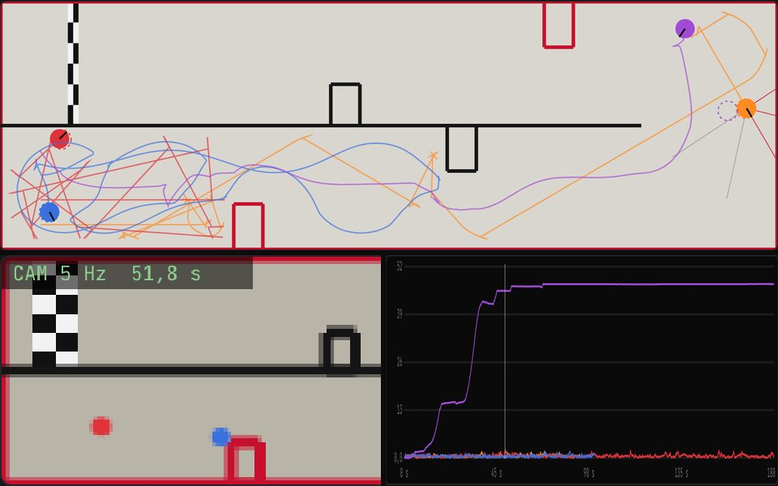

# Course de robots autonomes : obstacles, localisation et stratégies

🇫🇷 [Français](#français) · 🇬🇧 [English](#english)

**Essayer la démo :** https://valentin-auger-laboratoire.github.io/portfolio/demos/course-robots/



---

## Français

### D'où ça vient
En TP (décembre 2024), des petits robots autonomes faisaient la course. La piste était bordée de barrières **rouges** sur le bord et **noires** au milieu. La règle :
- au contact d'une barrière, le robot recule ;
- puis il repart du bon côté, selon la couleur touchée.

Une caméra au plafond permettait de suivre la course sur l'ordinateur. J'avais le robot orange, et j'ai gagné.

**Le programme d'origine est perdu.** Ce dépôt est une **simulation refaite de zéro en 2026**. Ce n'est pas le programme de 2024. Les valeurs du robot, des capteurs et de la caméra sont des **hypothèses** (ordres de grandeur).

### Le modèle
- **Robot à deux roues motrices** (modèle unicycle) : rayon de 5 cm, voie de 10 cm, 0,25 m/s.
- **Capteurs :**
  - un pare-chocs, qui détecte le contact et son côté ;
  - 5 télémètres infrarouges, à 0°, ±45° et ±90°, portée 40 cm, bruit de 8 mm ;
  - un capteur de couleur à l'avant ;
  - des codeurs sur les roues.
- **Odométrie :** les codeurs comptent la rotation des roues, même quand le robot patine contre un mur. Les deux roues n'ont pas tout à fait le même diamètre (+0,4 % / −0,3 %). L'estimation de la position dérive donc.
- **Caméra au plafond :** position et cap à 5 Hz, quantifiés à 2 cm par pixel et bruités. Un **filtre de Kalman étendu** les fusionne avec l'odométrie.
- **Contacts :** le robot est repoussé hors des murs et des autres robots, et le pare-chocs se déclenche.

### Les stratégies
| Stratégie | Principe | Localisation nécessaire |
|---|---|---|
| Couleurs (règle du TP) | Au contact, recule, puis s'écarte par la droite du noir et par la gauche du rouge : il garde le noir à sa gauche | aucune |
| Rebond aléatoire | Recule, puis tourne d'un angle au hasard | aucune |
| Suivi de mur | Régulateur PD sur la distance au mur de droite | aucune |
| Bug2 | Va vers l'arrivée, contourne ce qui le bloque, reprend sa ligne | oui |
| Champ de potentiel | Attiré par des points de passage, repoussé par les télémètres | oui |

### Résultats (30 courses, piste en U)
- **Les couleurs, le suivi de mur et Bug2** arrivent à chaque fois.
- **Le rebond aléatoire** n'arrive qu'environ 3 fois sur 10.
- **Le champ de potentiel** est le plus rapide (environ 30 s), mais seulement s'il est bien localisé :
  - avec l'odométrie seule, l'erreur atteint environ 40 cm et il n'arrive jamais ;
  - avec la caméra et le filtre de Kalman, l'erreur reste sous le centimètre et il arrive à chaque fois.

### Fichiers
| Fichier | Rôle |
|---|---|
| `robots.js` | Moteur : pistes, géométrie, capteurs, odométrie, filtre de Kalman, stratégies, courses et statistiques (testable avec Node) |
| `index.html` | Interface bilingue FR / EN : piste vue de dessus, caméra pixelisée, classement, erreur de localisation, statistiques |
| `tests/test.js` | 220 tests |

```bash
node tests/test.js
```
- Télémètres : distances exactes ; capteur de couleur.
- Filtre de Kalman : la prédiction égale l'odométrie, la mesure réduit l'incertitude, la covariance reste symétrique.
- Avec des codeurs parfaits et sans choc, l'odométrie suit le robot au millimètre près.
- Aucun robot ne traverse un mur ni un autre robot.
- L'arrivée exige le demi-tour.
- Résultats de chaque stratégie sur 20 courses par piste, et dérive de l'odométrie mise en évidence.

### Limites
- Modèle cinématique : pas d'inertie, pas de dynamique des moteurs.
- Contacts simplifiés.
- Une seule caméra, sans latence.
- Les pistes et les valeurs sont des hypothèses.

---

## English

### Background
In a lab (December 2024), small autonomous robots raced on a track with **red** edge barriers and **black** middle barriers. On contact, a robot backed off and set off again on the right side depending on the colour. A ceiling camera showed the race on the computer. I had the orange robot and won.

**The original program is lost.** This repository is a **simulation rebuilt from scratch in 2026**, not the 2024 program. Values are **assumed**.

### What it models
- A differential-drive robot with bumper, 5 IR range sensors, a colour sensor and wheel encoders.
- Odometry that drifts (wheel mismatch, slipping).
- A pixelated 5 Hz ceiling camera, fused with odometry by an extended Kalman filter.

### Strategies
Five strategies compete on three tracks: the lab colour rule, random bounce, PD wall following, Bug2 and a potential field.

On the U track, over 30 races:
- the colour rule, wall following and Bug2 always finish;
- random bounce finishes about 3 times in 10;
- the potential field is fastest, but needs the camera: with odometry alone it never finishes.

### Tests
`node tests/test.js`: 220 tests.

---

← [Portfolio](https://valentin-auger-laboratoire.github.io/portfolio/#projets)
